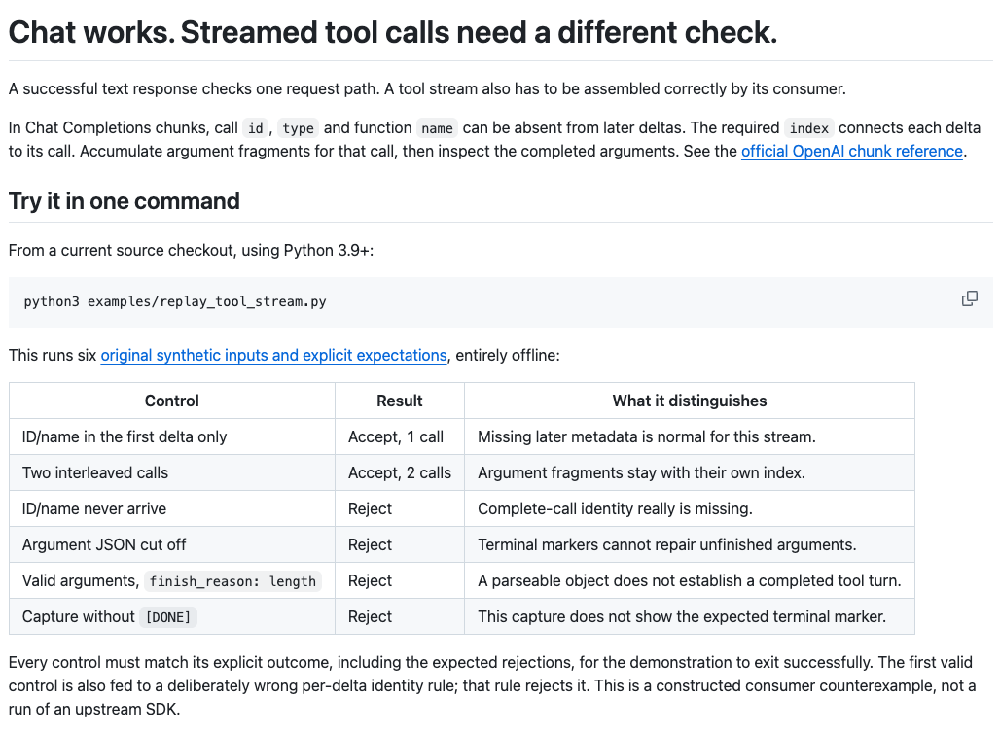

# LLM Endpoint Doctor｜大模型接口体检

**把 OpenAI 兼容 API 接进应用之前，先检查对话、工具调用、看图和生图接口。**

运行一条本地命令，检查 API 地址、模型 ID、鉴权和第一次对话响应。需要时再额外检查模型列表、流式输出、JSON 模式、工具调用、看图输入或单独的图片生成模型。

[English README](README.md) · [反馈问题](https://github.com/LydiaTools/llm-endpoint-doctor/issues)

## 为什么做这个工具

“兼容 OpenAI”仍可能遇到地址填错、模型 ID 已下线、服务商有特殊鉴权方式，或普通对话可用但流式不支持。LLM Endpoint Doctor 让你先做一次小检查，再把这些问题带进自己的应用调试。

它补充 API 资源目录：目录帮你找到接口，本工具检查你准备使用的接口。

**正在接入免费档模型？** [Groq、Gemini、OpenRouter 三家接入指南](docs/free-api-setup.zh-CN.md)列出正确地址、模型选择入口和可复制的单次检查。[English guide](docs/free-api-setup.md)。

**准备启动 Agent 循环？** [先核对计费项目和请求次数](docs/api-cost-preflight.zh-CN.md)：包含 Gemini 当前支出上限入口、报表延迟，以及默认和可选检查的无需 Key 实测请求数。

## 快速开始

需要 Python 3.9 或更新版本，无第三方运行依赖。

想直接安装预构建包？下载 [v0.6.2 Alpha wheel](https://github.com/LydiaTools/llm-endpoint-doctor/releases/download/v0.6.2/llm_endpoint_doctor-0.6.2-py3-none-any.whl)，并使用随包提供的 [SHA-256 文件](https://github.com/LydiaTools/llm-endpoint-doctor/releases/download/v0.6.2/llm_endpoint_doctor-0.6.2-py3-none-any.whl.sha256)核对。当前版本为 Alpha 预览。

在下载文件所在目录执行，无需克隆仓库：

```bash
python3 -m venv .venv
source .venv/bin/activate
python -m pip install --no-index --no-deps ./llm_endpoint_doctor-0.6.2-py3-none-any.whl
llm-doctor --version
```

上方命令用于 macOS/Linux。Windows PowerShell 用 `py -3 -m venv .venv` 创建环境、`.venv\Scripts\Activate.ps1` 激活，然后运行相同的 `python -m pip install` 和 `llm-doctor --version` 命令。

也可安装当前源码；后文的本地模拟服务示例包含在源码中：

```bash
git clone https://github.com/LydiaTools/llm-endpoint-doctor.git
cd llm-endpoint-doctor
python3 -m venv .venv
source .venv/bin/activate
python -m pip install .
llm-doctor --base-url https://api.example.com/v1 --model your-model-id
```

API Key 会通过隐藏输入提示读取。无 Key 接口直接回车。默认只发送 **一条**聊天补全请求。

默认输出预算刻意保持很小：普通聊天12 token，JSON检查和看图检查24 token，工具调用检查128 token。使用思考型模型时，可显式增加预算，例如 `--max-output-tokens 1024`；服务商要求新参数名时，再选 `--token-field max_completion_tokens`。设置会应用到每个已选生成检查，不增加请求或自动重试。`finish_reason=length`会明确标为截断，即使已有部分文字、合法JSON、用量或SSE的`[DONE]`也不算该项完整通过。[无需Key的复现步骤](docs/free-api-setup.zh-CN.md#不用key复现输出预算问题)。

```text
LLM Endpoint Doctor
Target host: https://api.example.com
Model: your-model-id

[PASS] chat completion — 收到符合预期格式的非空回复。

Basic chat: READY
报告不包含 API Key、提示词或回复内容。
```

## 不用服务商 Key 也能先试

你可以先在本机跑完整流程，不用注册服务商，也不会向互联网发送请求。打开第二个终端，启动固定响应的模拟接口：

```bash
python3 examples/mock_openai_server.py
```

再运行体检命令：

```bash
llm-doctor \
  --base-url http://127.0.0.1:8765/v1 \
  --model demo-model \
  --no-prompt \
  --check-model-list \
  --check-streaming \
  --check-stream-options \
  --check-json-mode \
  --check-image-generation \
  --image-model demo-image-model \
  --check-vision-input \
  --check-tool-calling \
  --vision-model demo-vision-model
```

```text
[PASS] model catalog — 找到完全匹配的模型 ID。
[PASS] chat completion — 收到符合预期格式的非空回复。
[PASS] streaming — 收到 SSE 完成标记。
[PASS] stream options — 流式请求完成，并返回了请求的用量信息。
[PASS] JSON mode — 返回了 JSON 对象。
[PASS] image generation — 收到 Base64 或 HTTP(S) 图片 URL 形式的图片结果；未下载或保存媒体文件。
[PASS] vision input — 返回内容匹配内置颜色顺序。
[PASS] tool calling — 返回一条名称和参数结构都符合预期的函数调用；没有执行该函数。

Basic chat: READY
```

模拟服务只监听本机回环地址并返回固定响应。生图路径返回合成占位值，并不是真实图片字节；它展示请求和报告流程，不代表已测试任何外部服务。按 `Ctrl+C` 停止。

## 聊天正常，流式工具调用却失败？

先复现协议层的小例子，再判断要不要换模型。使用当前仓库源码，无需 Key、模型、服务或安装包：

```bash
python3 examples/replay_tool_stream.py
```

六组原创离线对照会接受「只在首个增量发送名称／ID」及交错的多次调用，拒绝完整调用身份缺失、JSON 不完整及输出上限中断。即使参数 JSON 完整，`finish_reason=length` 也不会被当成已完成的工具轮次。反例另展示了为何逐块强制要求名称和 ID 会误拒正常数据。

也可用 `--file capture.sse` 检查本机捕获；只输出判断、固定原因与调用数量，不执行工具。[实际对照、输出与中英文排查步骤](docs/tool-stream-replay.md)。下面的可选 `--check-tool-calling` 会单独检查真实接口是否返回符合预期的函数调用结构；不会执行函数，也不检查流式工具调用处理。



*公开指南实景截图：原创合成回放对照，不代表真实 Provider 性能测试。*

## 可选检查

每项已选择的检查都会增加一次请求。流式、stream options、JSON、工具调用、生图和看图分别增加一次生成请求；模型列表检查增加一次 GET。

```bash
llm-doctor \
  --base-url https://api.example.com/v1 \
  --model your-model-id \
  --check-model-list \
  --check-streaming \
  --check-stream-options \
  --check-json-mode \
  --json-report endpoint-report.json
```

只有目标文件不存在时才会创建 JSON 报告。报告包含目标主机、模型 ID、检查结果和耗时，不包含 API Key、URL 路径、提示词或回复内容。

检查单独的生图模型时，显式增加一次图片生成请求：

```bash
llm-doctor \
  --base-url https://api.example.com/v1 \
  --model your-chat-model \
  --check-image-generation \
  --image-model your-image-model
```

工具会向 `POST /images/generations` 发送一条固定提示词（`A simple blue circle centered on a plain white background.`），`n=1`。它与对话检查共用 `--base-url` 和 API Key，但图片模型可以不同。图片生成可能产生服务商费用。工具只检查是否返回非空 Base64 图片字段或 HTTP(S) 图片 URL，不下载、不保存图片。响应只在检查期间保留，解析上限为 32 MB。[OpenAI 图片生成 API 文档](https://developers.openai.com/api/reference/resources/images/methods/generate)。

## 检查看图输入

使用 `llm-doctor --check-vision-input` 会额外向 `POST /chat/completions` 发送一次请求，包含一张内置的合成 PNG Base64 data URL。图片有四个颜色象限。默认使用聊天模型；`--vision-model` 可以指定另一个模型。

只有回复匹配预期的顺时针颜色顺序才通过；不匹配会标记为“尚未确认”。这是一项冒烟检查，不是准确率评测，也不能证明视觉能力质量。服务商会收到这条图片请求，并可能计费。图片在内存中生成，不从网址抓取，也不写入磁盘。[OpenAI 看图输入格式](https://developers.openai.com/api/docs/guides/images-vision)。

## 检查工具调用

```bash
llm-doctor --base-url https://api.example.com/v1 --model your-model-id --check-tool-calling
```

该检查会额外发送一次带单个必选函数定义的 `POST /chat/completions`。只有接口返回一条 `tool_calls`，且函数名称和 JSON 参数都符合预期时才通过。不会执行函数。它只确认所选模型的一种响应结构，不是语义能力评测，也不保证所有 Schema、提示词、流式消费者或后续请求都可用。服务商可能计量该请求或收费。

## 非交互模式与 CI

无 Key 接口可以显式跳过输入提示：

```bash
llm-doctor --base-url http://localhost:8000/v1 --model local-model --no-prompt
```

CI 中可以从环境变量读取 Key，避免把它放进命令行参数：

```yaml
- name: Check LLM endpoint
  env:
    LLM_API_KEY: ${{ secrets.LLM_API_KEY }}
  run: >-
    llm-doctor --base-url https://api.example.com/v1
    --model your-model-id --api-key-env LLM_API_KEY
```

指定的环境变量缺失或为空时，命令会在发送请求前停止。

## 检查内容

- **普通对话：** 向 `/chat/completions` 发送一条短测试提示，确认返回符合 OpenAI Chat 格式的文本。
- **模型列表（可选）：** 检查 `/models` 是否列出完全匹配的模型 ID。部分服务商使用别名或不完整目录，因此未列出只显示提醒，不直接判定对话失败。
- **流式输出（可选）：** 检查是否收到 server-sent events 结束标记；单行 JSON 数据事件报告错误时，即使后面有结束标记也会提示警告。
- **流式选项（可选）：** 在流式请求中发送 `stream_options: {"include_usage": true}`，检查端点是否接受该参数并返回用量信息。普通流式可用但不兼容此客户端选项时，这项检查会给出提醒。
- **JSON 模式（可选）：** 请求返回 JSON 对象，并检查内容能否解析为对象。
- **工具调用（可选）：** 使用 `--check-tool-calling` 时，额外发送一次带固定函数 Schema 的聊天请求，检查是否返回名称和参数都符合预期的函数调用；不会执行函数，也不评价语义可靠性。
- **图片生成（可选）：** 使用 `--check-image-generation --image-model ID` 时，向 `/images/generations` 额外发送一次固定提示词，检查是否返回非空 `data[].b64_json` 或 HTTP(S) `data[].url`。不会抓取 URL、解码或保存图片字节，也不评价图片质量。
- **看图输入（可选）：** 使用 `--check-vision-input` 时，额外发送一次含内置合成 PNG data URL 的聊天请求，并检查回复是否匹配四个颜色象限；不匹配时保持未确认。这不是视觉质量评测。
- **常见故障：** 区分鉴权/权限错误、接口或模型不存在、速率限制、服务错误、超时和 TLS 错误，不输出服务商的原始错误正文。

当单行 JSON 事件的 `choices` 为 null 或空数组，且 `error_type` 和 `error_message` 均为非空字符串时，也会提示流内错误。这项对照基于[公开问题](https://github.com/NousResearch/hermes-agent/issues/65631)描述的字段构造合成事件，并非捕获的原始响应或真实服务商测试。工具不会打印服务商的错误消息。

这些可选检查分别报告警告。CLI 退出码仍只依据基础聊天是否就绪，因此聊天成功时，即使流式检查有警告也可能退出 0；请查看单项结果或 JSON 报告。这里检查的是有限范围内的单行 SSE 事件，不是完整的流式客户端兼容性测试。

工具不会自动重试，不评价回答质量、不做服务商跑分、不保证兼容每种客户端，也不能判断服务商的免费额度会长期不变。

## 隐私与请求处理

- API Key 通过隐藏输入或指定的环境变量读取，只放在发往你指定接口的 Authorization 请求头中；工具不会把它写入文件。
- 工具没有遥测或账号系统。
- 报告省略 API Key、URL 路径、提示词和回复正文。
- 远程接口必须使用 HTTPS；只有 localhost 测试允许普通 HTTP。
- 工具拒绝 URL 查询参数、内嵌凭据和跨域跳转，避免将 Key 转发给其他主机。
- 接口服务商会收到测试请求，并可能按自己的规则计量。可选检查会增加请求次数，只在需要时启用。
- 图片检查会向接口发送固定提示词并可能产生图片生成费用；只请求一张图片且不会保存返回图片。超过大小上限的响应不会被解析。
- 看图检查会向接口发送一张内置合成图片，可能产生服务商费用。图片在内存中生成且不会保存；不会重复或跟进发送请求。
- 工具调用检查会向接口发送固定函数 Schema 和提示词；不会执行返回的函数或保存回复，也不会重复发送。

## 开发

```bash
PYTHONPATH=src python3 -m unittest discover -s tests -v
```

测试使用本地模拟服务，不连接外部接口，也不使用真实 API Key。

## 许可证

MIT，详见 [LICENSE](LICENSE)。
